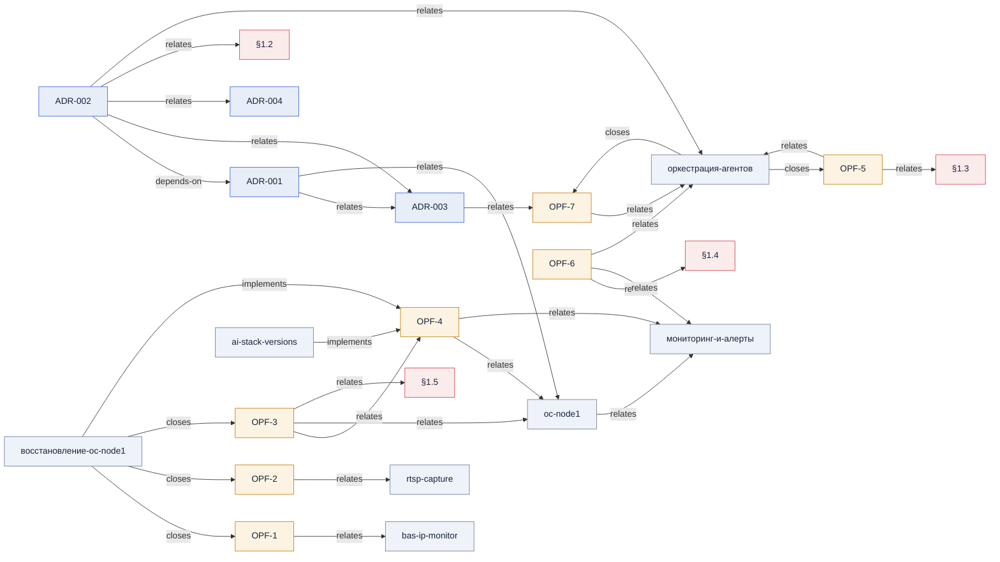

# Граф знаний — типизированные связи (АВТОГЕН)

> **Не править вручную.** Генерируется из строк `Связи[…]` в `docs/` по конвенции
> [`СВЯЗИ-конвенция.md`](СВЯЗИ-конвенция.md). Перегенерировать: `python scripts/gen-knowledge-graph.py`.

## Список связей (для grep)

- ADR-001 —relates→ ADR-003
- ADR-001 —relates→ oc-node1
- ADR-002 —depends-on→ ADR-001
- ADR-002 —relates→ ADR-003
- ADR-002 —relates→ ADR-004
- ADR-002 —relates→ §1.2
- ADR-002 —relates→ оркестрация-агентов
- ADR-003 —relates→ OPF-7
- OPF-1 —relates→ bas-ip-monitor
- OPF-2 —relates→ rtsp-capture
- OPF-3 —relates→ OPF-4
- OPF-3 —relates→ oc-node1
- OPF-3 —relates→ §1.5
- OPF-4 —relates→ oc-node1
- OPF-4 —relates→ мониторинг-и-алерты
- OPF-5 —relates→ §1.3
- OPF-5 —relates→ оркестрация-агентов
- OPF-6 —relates→ §1.4
- OPF-6 —relates→ мониторинг-и-алерты
- OPF-6 —relates→ оркестрация-агентов
- OPF-7 —relates→ оркестрация-агентов
- ai-stack-versions —implements→ OPF-4
- oc-node1 —relates→ мониторинг-и-алерты
- восстановление-oc-node1 —closes→ OPF-1
- восстановление-oc-node1 —closes→ OPF-2
- восстановление-oc-node1 —closes→ OPF-3
- восстановление-oc-node1 —implements→ OPF-4
- оркестрация-агентов —closes→ OPF-5
- оркестрация-агентов —closes→ OPF-7
