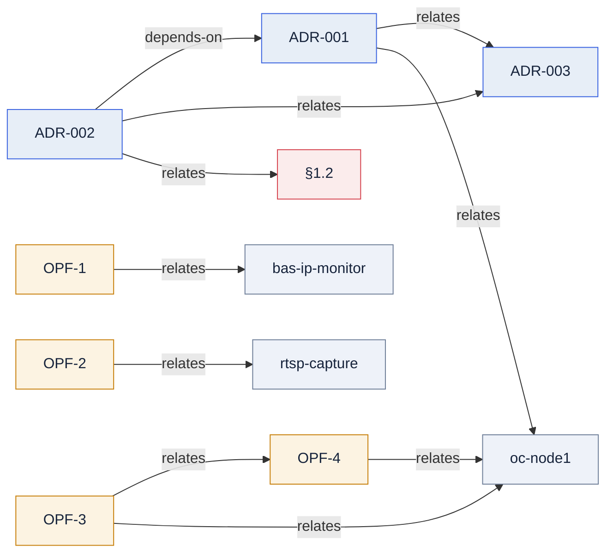

# Граф знаний — типизированные связи (АВТОГЕН)

> **Не править вручную.** Генерируется из строк `Связи[…]` в `docs/` по конвенции
> [`СВЯЗИ-конвенция.md`](СВЯЗИ-конвенция.md). Перегенерировать: `python scripts/gen-knowledge-graph.py`.

## Список связей (для grep)

- ADR-001 —relates→ ADR-003
- ADR-001 —relates→ oc-node1
- ADR-002 —depends-on→ ADR-001
- ADR-002 —relates→ ADR-003
- ADR-002 —relates→ §1.2
- OPF-1 —relates→ bas-ip-monitor
- OPF-2 —relates→ rtsp-capture
- OPF-3 —relates→ OPF-4
- OPF-3 —relates→ oc-node1
- OPF-4 —relates→ oc-node1
